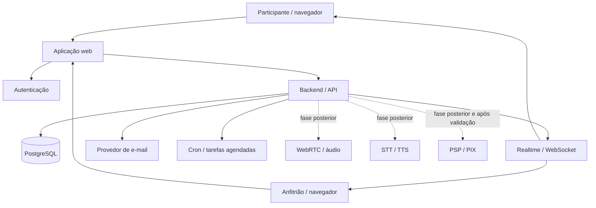
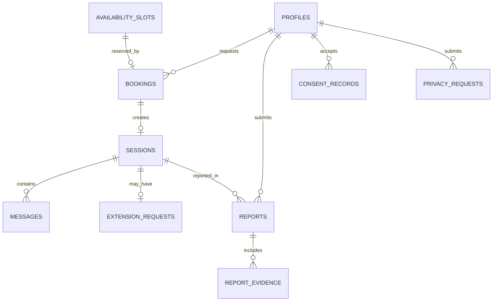

# Arquitetura técnica e banco de dados

**Plataforma de conversas de companhia — MVP web**

- **Versão:** 1.0 — 02/11/2026
- **Escopo:** Brasil; um anfitrião; participantes maiores de 18 anos; cadastro obrigatório; antecedência mínima de 12 horas; conversas gratuitas; chat como padrão; histórico por 30 dias; áudio/STT/TTS em fase posterior; doação PIX opcional e ainda sujeita à validação de privacidade e tributação.

> Este documento é uma arquitetura de referência para orientar implementação. Antes de produção, revisar segurança, privacidade, contratos de fornecedores e obrigações jurídicas/tributárias.

---

## 1. Decisões de produto que a arquitetura deve respeitar

| Tema | Regra implementada |
|---|---|
| Operação | Pessoa física, com marca pública |
| Público | 18 anos ou mais |
| Cadastro | Obrigatório e com e-mail verificado |
| Agendamento | Solicitação depende de aceite do anfitrião |
| Antecedência | Pelo menos 12 horas, validada no servidor |
| Conversa inicial | 15 minutos |
| Extensão | Um pedido, disponível a partir de 14:00; até mais 15 minutos; depende de aceite do anfitrião e ausência de conflito |
| Encerramento | Qualquer lado pode encerrar a qualquer momento |
| Histórico | Participante consulta seu histórico por até 30 dias após a sessão |
| Acesso do anfitrião | Somente mensagens selecionadas pelo participante e anexadas a uma denúncia; exceções legais tratadas separadamente |
| Exclusão | Excluir uma conversa ou todo o histórico |
| Áudio | Sem gravação por padrão; sem vídeo |
| Doação | Opcional, pós-sessão, PIX; implementação depende de solução que apresente claramente o recebedor sem mascarar titularidade |
| Identidade pública | Marca no produto; identificação legal do controlador nos documentos obrigatórios |

---

## 2. Arquitetura recomendada

### 2.1 Estilo arquitetural

Começar com um **monólito modular**: uma aplicação web e uma API/backend com módulos bem separados. Para um produto operado por uma pessoa e com um anfitrião, microserviços aumentariam custo operacional sem benefício inicial claro.

### 2.2 Stack de referência

| Camada | Recomendação inicial | Responsabilidade |
|---|---|---|
| Frontend | Next.js + TypeScript | Site responsivo, conta, agenda, sala e painel do anfitrião |
| UI | Componentes acessíveis e design system simples | Navegação por teclado, mobile, estados de conexão e temporizador |
| Autenticação | Supabase Auth ou serviço equivalente | Cadastro, login, verificação de e-mail, recuperação de conta |
| Banco | PostgreSQL gerenciado | Fonte oficial de dados e transações |
| Realtime | Supabase Realtime ou WebSocket autenticado | Entrega de mensagens e atualização de estado |
| Backend | Route Handlers/API server-side ou funções server-side | Regras de negócio, autorização, reservas, extensão e exclusão |
| Agendador | Cron gerenciado/pg_cron | Expiração do histórico, lembretes e tarefas periódicas |
| E-mail | Provedor transacional | Verificação, confirmação, cancelamento e lembretes |
| Mídia (fase posterior) | WebRTC via fornecedor especializado, por exemplo LiveKit | Áudio ao vivo sem vídeo |
| STT/TTS (fase posterior) | Fornecedores selecionados após avaliação de privacidade | Transcrição sob comando e leitura de texto |
| Observabilidade | Logs estruturados + métricas + alertas | Saúde técnica sem conteúdo de conversa |

A escolha Supabase é uma opção pragmática, não uma exigência. Se utilizado, habilitar **Row Level Security (RLS)** em todas as tabelas acessíveis pelo cliente. Nunca colocar chave `service_role` no navegador. Operações sensíveis devem passar pelo backend e usar transações no PostgreSQL.

### 2.3 Diagrama lógico

> Diagrama reconstruído a partir dos rótulos do documento original (o export original trazia apenas o código de renderização).

### 2.4 Limites de confiança

- O navegador nunca decide se uma reserva foi aceita, se uma extensão foi aprovada ou quando a sessão termina.
- O servidor é a fonte oficial de horário e estado.
- O cliente não recebe credenciais privilegiadas do banco.
- Mensagens são enviadas e lidas somente após autorização no backend/RLS.
- O anfitrião não recebe uma API para listar o conteúdo de todos os históricos.
- O repositório de evidências de denúncia é separado do histórico normal.
- Logs, analytics e ferramentas de erro não devem capturar corpo de mensagens, tokens, áudio ou dados de autenticação.

---

## 3. Módulos da aplicação

1. **Identidade e conta:** cadastro, login, e-mail verificado, confirmação de maioridade, bloqueio e exclusão de conta.
2. **Agenda:** disponibilidade publicada pelo anfitrião, horários elegíveis e antecedência mínima.
3. **Reservas:** solicitação, aceite/recusa, cancelamento e notificações.
4. **Sessões:** sala, início, relógio de servidor, encerramento e reconexão.
5. **Mensagens:** chat em tempo real e histórico com expiração de 30 dias.
6. **Extensões:** solicitação aos 14 minutos, decisão do anfitrião e reserva atômica do tempo adicional.
7. **Denúncias:** seleção voluntária de mensagens, evidência restrita, análise e bloqueio.
8. **Privacidade:** exportação, exclusão individual/global, retenção e auditoria de acesso.
9. **Doações:** módulo desativado até validação do PSP, nome exibido ao pagador e tratamento tributário.
10. **Voz:** áudio, STT e TTS como fase posterior, com ativação voluntária e sem gravação por padrão.

---

## 4. Modelo de dados

### 4.1 Convenções

- Chaves primárias UUID.
- Timestamps armazenados como `timestamptz` em UTC.
- Apresentação inicial em America/Sao_Paulo.
- Valores monetários, quando houver, em centavos inteiros (`bigint`) e moeda ISO (BRL).
- Estados representados por enums ou `text` com CHECK.
- Exclusão de conta e conteúdo devem ser processos explícitos; não usar cascade indiscriminado em dados que possam precisar ser preservados por obrigação legal.
- O provedor de autenticação é a fonte da credencial; não armazenar senha em texto ou criar hash próprio se Auth gerenciado for utilizado.

### 4.2 Entidades e relações

> Diagrama reconstruído a partir dos rótulos do documento original.

### 4.3 Tabelas

#### profiles
Perfil mínimo associado ao usuário do provedor de autenticação.

- `user_id uuid primary key` — mesmo ID do Auth.
- `display_name text not null` — apelido/nome público.
- `adult_confirmed_at timestamptz not null`.
- `email_verified_at timestamptz` — sincronizado do Auth, se necessário.
- `status text not null` — `active`, `suspended`, `deletion_pending`, `deleted`.
- `created_at`, `updated_at timestamptz`.

Evitar guardar data de nascimento completa ou documento se a confirmação proporcional de maioridade for suficiente.

#### consent_records

- `id uuid primary key`.
- `user_id uuid not null`.
- `document_type text not null` — `terms`, `privacy`, `community_rules`.
- `document_version text not null`.
- `accepted_at timestamptz not null`.
- `withdrawn_at timestamptz null` quando aplicável.
- `created_at timestamptz not null`.

Guardar prova da versão aceita; não registrar IP por padrão sem necessidade documentada.

#### availability_slots
Horários concretos publicados pelo anfitrião.

- `id uuid primary key`.
- `starts_at timestamptz not null`.
- `ends_at timestamptz not null`.
- `status text not null` — `open`, `hidden`, `closed`.
- `created_at`, `updated_at timestamptz`.
- `CHECK (ends_at > starts_at)`.

Slots devem ter duração compatível com a sessão inicial de 15 minutos e eventuais intervalos definidos. A interface nunca deve inferir disponibilidade apenas pelo calendário do cliente.

#### bookings

- `id uuid primary key`.
- `slot_id uuid not null unique references availability_slots(id)`.
- `participant_id uuid not null references profiles(user_id)`.
- `status text not null` — `requested`, `accepted`, `declined`, `cancelled_by_participant`, `cancelled_by_host`, `expired`, `completed`, `no_show`.
- `requested_at timestamptz not null`.
- `decided_at timestamptz null`.
- `cancelled_at timestamptz null`.
- `decision_note_code text null` — código categorizado, sem texto íntimo.
- `created_at`, `updated_at timestamptz`.

A aplicação valida que `slot.starts_at >= now() + interval '12 hours'` no momento da solicitação e novamente ao aceitar. A regra deve ser aplicada no backend, nunca somente no frontend.

#### sessions

- `id uuid primary key`.
- `booking_id uuid not null unique references bookings(id)`.
- `status text not null` — `scheduled`, `active`, `ended`, `expired`, `cancelled`.
- `started_at timestamptz null`.
- `initial_ends_at timestamptz not null`.
- `ends_at timestamptz not null` — passa a refletir a extensão aprovada.
- `ended_at timestamptz null`.
- `ended_by uuid null references profiles(user_id)`.
- `created_at`, `updated_at timestamptz`.

`initial_ends_at` e `ends_at` são definidos no servidor. Não confiar no contador local.

#### messages

- `id uuid primary key`.
- `session_id uuid not null references sessions(id)`.
- `sender_id uuid not null references profiles(user_id)`.
- `body text not null`.
- `created_at timestamptz not null`.
- `expires_at timestamptz not null` — preenchido após o encerramento: `ended_at + 30 days`.
- `deleted_at timestamptz null` — exclusão solicitada, se for necessário um estado transitório.

Índices: `(session_id, created_at)`, `(expires_at)`, `(sender_id, created_at)`. Limitar tamanho de mensagem e frequência. Não armazenar áudio bruto ou transcrição automática não enviada.

#### extension_requests

- `id uuid primary key`.
- `session_id uuid not null unique references sessions(id)` — no máximo um pedido por sessão.
- `requested_at timestamptz not null`.
- `decision text not null` — `pending`, `accepted`, `declined`, `expired`, `conflict`.
- `decided_at timestamptz null`.
- `decided_by uuid null references profiles(user_id)`.
- `new_ends_at timestamptz null`.

O servidor só aceita solicitação quando `requested_at >= started_at + interval '14 minutes'` e antes do encerramento inicial. Se não houver decisão até `initial_ends_at`, marcar como `expired`.

#### host_time_blocks
Bloqueios efetivos da agenda para evitar sobreposição entre sessões confirmadas e extensões.

- `id uuid primary key`.
- `booking_id uuid not null references bookings(id)`.
- `time_range tstzrange not null`.
- `block_type text not null` — `initial_session`, `extension`.
- `created_at timestamptz not null`.

Criar uma **constraint de exclusão** PostgreSQL usando `btree_gist` para impedir intervalos sobrepostos ativos para o mesmo anfitrião. Como há um único anfitrião no MVP, pode-se usar uma coluna constante `host_key` e excluir ranges que se sobreponham quando o bloqueio estiver ativo. A extensão deve **atualizar o intervalo do bloqueio existente** daquela reserva (em vez de inserir um segundo intervalo que se sobreponha ao próprio bloqueio inicial), dentro de transação. Se a constraint falhar por sobreposição com outra reserva, a extensão é recusada como conflito.

#### reports

- `id uuid primary key`.
- `reporter_id uuid not null references profiles(user_id)`.
- `session_id uuid not null references sessions(id)`.
- `category text not null` — categorias predefinidas.
- `description text null` — aviso para não inserir dados desnecessários de terceiros.
- `status text not null` — `open`, `reviewing`, `closed`, `escalated`.
- `created_at`, `closed_at timestamptz`.

#### report_evidence
Cópia mínima de mensagens que o participante escolheu anexar à denúncia.

- `id uuid primary key`.
- `report_id uuid not null references reports(id)`.
- `original_message_id uuid null` — referência informativa, não dependência para preservar evidência.
- `message_snapshot text not null`.
- `sender_label text not null` — evitar expor mais dados que o necessário.
- `message_created_at timestamptz not null`.
- `retention_until timestamptz not null`.
- `created_at timestamptz not null`.

Esta tabela tem permissões mais restritas que `messages`. O participante escolhe explicitamente o material antes do envio da denúncia. Definir prazo de retenção próprio e justificável para evidências.

#### privacy_requests

- `id uuid primary key`.
- `user_id uuid not null references profiles(user_id)`.
- `request_type text not null` — `export`, `delete_one_conversation`, `delete_all_history`, `account_delete`.
- `target_session_id uuid null references sessions(id)`.
- `status text not null` — `received`, `processing`, `completed`, `rejected_with_reason`.
- `requested_at`, `completed_at timestamptz`.
- `reason_code text null`.

#### admin_audit_log

- `id uuid primary key`.
- `actor_id uuid not null`.
- `action text not null`.
- `target_type text not null`.
- `target_id uuid null`.
- `reason_code text not null`.
- `created_at timestamptz not null`.

Não incluir corpo de mensagem, tokens ou credenciais no log. O acesso a evidências de denúncia gera evento de auditoria.

#### donation_events
Criar somente quando o fluxo PIX estiver validado.

- `id uuid primary key`.
- `provider text not null`.
- `provider_reference text unique not null`.
- `amount_cents bigint not null check (amount_cents > 0)`.
- `currency char(3) not null default 'BRL'`.
- `status text not null` — `pending`, `received`, `refunded`, `reversed`, `failed`.
- `received_at timestamptz null`.
- `created_at timestamptz not null`.

Não criar cadastro de doador se não for necessário. Guardar somente o que for exigido para conciliação e obrigações legais. O nome exibido pelo PSP deve ser informado ao contribuinte antes da transferência.

---

## 5. Regras transacionais críticas

### 5.1 Solicitar horário

1. Iniciar transação.
2. Bloquear a linha do slot (`SELECT ... FOR UPDATE`).
3. Confirmar que o slot está `open`.
4. Confirmar que o início está pelo menos 12 horas à frente do horário do banco.
5. Confirmar que o participante está ativo e maioridade confirmada.
6. Criar booking `requested` e marcar o slot como reservado temporariamente ou indisponível para outra solicitação.
7. Commit.
8. Enviar notificação fora da transação; falhas de e-mail não desfazem a reserva.

Definir prazo para solicitações pendentes. Ao expirar, liberar o slot em uma transação.

### 5.2 Aceitar reserva

1. Bloquear booking e slot.
2. Confirmar que booking ainda está `requested`.
3. Confirmar que o horário ainda respeita a antecedência mínima e não conflita com outro bloqueio.
4. Criar `session` e `host_time_block` de 15 minutos.
5. Atualizar booking para `accepted` e slot para estado não disponível.
6. Commit.

### 5.3 Iniciar sessão

- Participante e anfitrião autenticados entram na sala.
- O backend valida que ambos são os atores autorizados.
- Definir `started_at` uma única vez e calcular `initial_ends_at = started_at + 15 minutes`.
- Se a sessão não começar dentro da janela operacional, aplicar regra de expiração/no-show documentada.

### 5.4 Pedido e aprovação de extensão

1. Aceitar pedido somente a partir de `started_at + 14 minutes` e antes de `initial_ends_at`.
2. Garantir unicidade por `session_id`.
3. Notificar o anfitrião.
4. Ao aceitar, iniciar transação e bloquear a sessão e a agenda.
5. Confirmar que a sessão ainda está ativa e que a decisão ocorre antes de `initial_ends_at`.
6. Atualizar o `time_range` do bloqueio existente para terminar em `started_at + 30 minutes` (não inserir outro bloqueio sobreposto à mesma reserva).
7. A constraint de exclusão impede colisão com outro compromisso.
8. Se sem conflito, atualizar `sessions.ends_at` e `extension_requests.decision = accepted`.
9. Se houver conflito, registrar `conflict` e manter `ends_at = initial_ends_at`.
10. Se não houver resposta até o término, marcar `expired`.

A operação deve ser **idempotente**: repetir a mesma requisição não pode conceder duas extensões.

### 5.5 Encerrar sessão e aplicar retenção

- Encerrar via operação server-side idempotente.
- Gravar `ended_at` e `ended_by`.
- Definir `messages.expires_at = ended_at + interval '30 days'` para as mensagens da sessão.
- Agendar notificação de encerramento e exibir tela pós-sessão.
- O job de expurgo remove mensagens expiradas dos sistemas ativos.
- Backups expiram segundo política separada e documentada.

---

## 6. Autorização e RLS

Ativar RLS em todas as tabelas expostas ao cliente.

| Recurso | Participante | Anfitrião |
|---|---|---|
| Próprio perfil | Ler/editar campos permitidos | Não precisa de acesso amplo |
| Agenda pública | Ler slots abertos | Gerenciar |
| Próprias reservas | Ler/cancelar conforme regra | Ler/decidir reservas |
| Sala ativa | Entrar se for participante da sessão | Entrar se for anfitrião da sessão |
| Mensagens da sessão | Ler enquanto participante autorizado e dentro da retenção | Não listar histórico; durante sessão ativa, ler mensagens em tempo real é inerente à conversa |
| Histórico encerrado | Ler as próprias conversas ainda retidas | Sem acesso rotineiro |
| Evidência de denúncia | Enviar mensagens selecionadas | Ler somente denúncias atribuídas e com auditoria |
| Logs administrativos | Não | Somente ações administrativas estritamente necessárias |

**Importante:** durante uma conversa, o anfitrião naturalmente vê as mensagens ao vivo como interlocutor. A restrição é sobre acesso posterior e navegação no histórico, não sobre esconder mensagens que foram enviadas na sessão.

Não confiar apenas em esconder botões na interface. Todas as verificações devem existir no backend e, quando aplicável, em políticas RLS.

---

## 7. API — endpoints sugeridos

Os nomes são ilustrativos; a implementação pode usar REST, RPC ou server actions, desde que as regras sejam equivalentes.

### Conta

- `POST /api/account/confirm-adult`
- `GET /api/me`
- `PATCH /api/me`
- `POST /api/privacy/export`
- `POST /api/privacy/delete-history`

### Agenda e reservas

- `GET /api/availability?from=...&to=...`
- `POST /api/bookings`
- `GET /api/bookings/mine`
- `POST /api/host/bookings/:id/accept`
- `POST /api/host/bookings/:id/decline`
- `POST /api/bookings/:id/cancel`

### Sessões e mensagens

- `POST /api/sessions/:id/join`
- `POST /api/sessions/:id/end`
- `GET /api/sessions/:id/messages`
- `POST /api/sessions/:id/messages`
- `POST /api/sessions/:id/report`

### Extensão

- `POST /api/sessions/:id/extension-requests`
- `POST /api/host/extension-requests/:id/accept`
- `POST /api/host/extension-requests/:id/decline`

Toda operação mutável deve validar autenticação, autorização, estado atual, rate limit e idempotência.

---

## 8. Segurança e privacidade — controles mínimos

- HTTPS/TLS obrigatório.
- MFA para conta do anfitrião.
- Senhas gerenciadas por provedor confiável; proteção contra credential stuffing.
- RLS e testes de acesso horizontal entre usuários.
- Limite de tamanho e frequência de mensagens.
- Proteção CSRF quando aplicável, CSP e validação de entrada.
- Tokens de sala de curta duração e escopo restrito.
- Chaves secretas somente no servidor.
- Criptografia em repouso para banco e backups.
- Backups com acesso restrito, prazo definido e testes de restauração.
- Logs sem corpo de mensagem, áudio, token ou senha.
- Acesso administrativo com MFA, privilégio mínimo e auditoria.
- Procedimento de incidente e canal para solicitações de titulares.
- Contratos e avaliação de operadores, suboperadores e transferências internacionais.
- Testes periódicos de autorização, retenção, exclusão e recuperação.

### Histórico e backups

"30 dias" significa disponibilidade do histórico nos sistemas ativos por até 30 dias após o encerramento. Se backups mantiverem cópias por um período adicional, a política precisa explicar esse ciclo. Não declarar que toda cópia é apagada instantaneamente se o sistema não consegue fazê-lo.

### Denúncias

Mensagens anexadas a uma denúncia são copiadas para um cofre lógico separado. O prazo de retenção dessa evidência é diferente dos 30 dias do histórico normal e precisa ser definido por análise de necessidade, risco e obrigação legal. Não preservar conversas inteiras por padrão.

---

## 9. Áudio, STT e TTS — fase posterior

- Usar WebRTC sem trilha de vídeo.
- Tokens de sala temporários, emitidos pelo backend após validar a sessão.
- Indicador visível de microfone ativo e controles para silenciar/sair.
- Não gravar áudio por padrão.
- STT somente após ação explícita; texto só entra no histórico após confirmação/envio.
- TTS somente após ação explícita; avaliar se o texto é enviado a terceiro.
- Exibir fornecedor e finalidade antes da primeira utilização e disponibilizar aviso na política.
- Avaliar retenção, treinamento, região de processamento, suboperadores e transferência internacional.
- Ter fallback para chat se o áudio falhar.

---

## 10. PIX e privacidade do responsável

O responsável prefere que seu nome civil não seja exposto publicamente. Isso não autoriza esconder o titular real do recebedor, do PSP ou das informações que o sistema financeiro exige.

Antes de implementar:

1. Consultar advogado(a) e contador(a) sobre a natureza das contribuições e operação como pessoa física.
2. Consultar PSP/banco sobre qual nome e dados aparecem ao pagador em chave, QR Code e comprovante.
3. Avaliar alternativa legítima de recebimento por entidade/estrutura adequada, se houver necessidade de marca no recebedor, sem simular titularidade.
4. Mostrar ao usuário o nome do recebedor apresentado pelo PSP antes da transferência.
5. Se não houver alternativa compatível com a privacidade desejada e a conformidade, manter doações desativadas no lançamento.

O módulo de doações deve permanecer feature-flagged/desabilitado até essa validação.

---

## 11. Deploy e ambientes

- **development:** dados fictícios; nunca importar conversas reais.
- **staging:** testes integrados com contas de teste e e-mails controlados.
- **production:** acesso restrito, segredos separados e backup habilitado.
- Migrações versionadas e revisadas.
- Deploy com rollback documentado.
- Monitoramento de erros e latência sem payloads privados.
- Testar restauração de backup e recuperação de conta.

---

## 12. Plano de implementação técnica

### Sprint 1 — Base

- [ ] Repositório, CI, ambientes e deploy inicial.
- [ ] Layout responsivo e páginas públicas.
- [ ] Autenticação, confirmação de e-mail e maioridade.
- [ ] Aceite versionado dos termos e política.
- [ ] RLS e testes básicos de autorização.

### Sprint 2 — Agenda

- [ ] Painel do anfitrião para criar/fechar slots.
- [ ] Consulta de disponibilidade.
- [ ] Solicitação de reserva com antecedência mínima de 12 horas.
- [ ] Aceite/recusa/cancelamento.
- [ ] Bloqueio transacional contra reservas duplicadas.
- [ ] Notificações por e-mail.

### Sprint 3 — Sessão e chat

- [ ] Sala autenticada.
- [ ] Mensagens em tempo real.
- [ ] Temporizador no servidor de 15 minutos.
- [ ] Encerramento por qualquer participante.
- [ ] Histórico privado com expiração em 30 dias.
- [ ] Exclusão de conversa individual e de todo o histórico.

### Sprint 4 — Extensão e segurança

- [ ] Botão aparece a partir de 14:00.
- [ ] Um pedido por sessão.
- [ ] Decisão do anfitrião.
- [ ] Reserva atômica do intervalo adicional e tratamento de conflito.
- [ ] Denúncia com seleção voluntária de mensagens.
- [ ] Cofre de evidências e auditoria de acesso.
- [ ] Testes de abuso, acesso indevido, reconexão e expurgo.

### Sprint 5 — Piloto e voz

- [ ] Piloto fechado.
- [ ] Revisão de privacidade e segurança.
- [ ] Áudio WebRTC sem vídeo.
- [ ] STT/TTS com aviso e ativação voluntária.
- [ ] Avaliação de fornecedores.

### Sprint 6 — Doações e lançamento

- [ ] Parecer tributário e jurídico sobre PIX.
- [ ] Validação do nome exibido pelo recebedor.
- [ ] Implementar fluxo opcional somente após aprovação.
- [ ] Revisão final dos documentos legais.
- [ ] Lançamento gradual.

---

## 13. Testes essenciais

### Agenda

- Duas solicitações simultâneas para o mesmo slot: apenas uma pode avançar.
- Solicitação com 11h59 de antecedência: rejeitada.
- Solicitação com 12h ou mais: elegível, se o slot estiver aberto.
- Slot cancelado/fechado durante a navegação: backend rejeita reserva.

### Sessão e extensão

- Botão não aparece antes de 14:00.
- Pedido antes de 14:00 é rejeitado também pela API.
- Pedido duplicado é rejeitado.
- Aceite sem conflito estende até `started_at + 30 minutes`.
- Aceite com conflito falha sem alterar o término original.
- Falta de resposta encerra no tempo original.
- Qualquer participante pode encerrar antes do limite.
- Alterar relógio do navegador não altera o tempo oficial.

### Histórico e privacidade

- Participante A não acessa conversa de B.
- Anfitrião não consegue listar históricos encerrados.
- Anfitrião acessa apenas evidências de denúncia autorizadas.
- Histórico expira aos 30 dias.
- Exclusão individual não apaga conversas não selecionadas.
- Exclusão global remove todo o histórico ativo do titular.
- Evidência de denúncia segue retenção própria e acesso auditado.
- Logs não contêm corpo de mensagem.

### Doações

- Nenhum botão de doação aparece antes do fim da sessão.
- Doar não altera agenda, prioridade, duração ou aceite.
- Destinatário exibido corresponde ao titular real informado pelo PSP.
- Se o recebedor não puder ser apresentado com clareza, o fluxo permanece desativado.

---

## 14. Decisões pendentes antes do desenvolvimento completo

1. Nome da marca e domínio.
2. Horizonte máximo de agendamento (por exemplo, 30 dias).
3. Duração da janela para o anfitrião aceitar uma solicitação pendente.
4. Política para atraso e não comparecimento.
5. Intervalo de segurança entre sessões.
6. Provedor de hospedagem/Auth/Realtime e região de dados.
7. Prazo de retenção específico de evidências de denúncia.
8. Solução legítima de PIX que atenda à preferência de privacidade, sem ocultar titularidade.
9. Texto final de Termos e Política revisado por profissional jurídico.

---

## 15. Princípio de implementação

O produto deve ser simples para quem conversa e rigoroso nos bastidores: horário oficial no servidor, acesso mínimo, histórico com expiração real, exclusão verificável, extensão transacional e nenhuma promessa jurídica ou de privacidade que a implementação não consiga cumprir.
